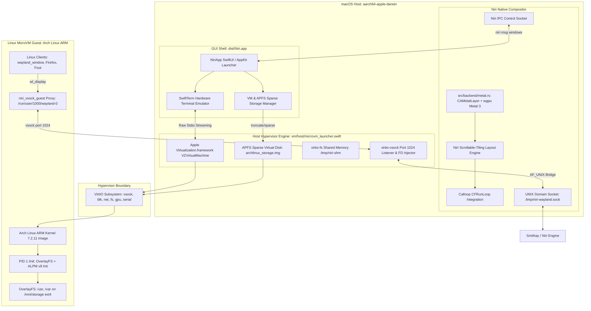

# Architecture Specification: Niri for macOS with MicroVM Pipeline

> **Notice**: For the full, comprehensive Engineering Handoff Guide, technical diagnostic of Wayland client presentation, and the roadmap for incoming developers/LLMs, see [docs/ARCHITECTURE_AND_HANDOFF.md](file:///Users/qteanimegirl/Downloads/NiriLinuxOnMac/docs/ARCHITECTURE_AND_HANDOFF.md).

## 1. System Overview

The objective is to execute the Niri scrollable-tiling compositor natively on macOS (`aarch64-apple-darwin`), displaying its workspace inside a native AppKit window rendered via Apple Metal, while hosting an ultra-fast Linux MicroVM that transparently runs Linux Wayland client applications.

## 2. Component Breakdown

### 2.1 Host AppKit / Metal Runtime
- **Window Shell**: A native macOS window managed via AppKit, hosting a `CAMetalLayer` (`src/backend/metal.rs`).
- **Render Engine**: Leverages `wgpu` with the Metal backend (`wgpu::Backends::METAL`), presenting frame textures directly into the swapchain.
- **Event Loop Integration**: Smithay uses `calloop`. On macOS, `calloop` integrates with the macOS run loop or executes on the main thread via timer/socket polling hooks.
- **Display Modes**: Supports native windowed mode (`NIRI_WINDOWED=1`) and single-space notch bypass fullscreen (`NSWindowCollectionBehaviorFullScreenAuxiliary`, level `0`).

### 2.2 Wayland Compositor Core
- Decoupled from Linux DRM/GBM/udev/seatd/libinput.
- Manages Wayland client surfaces, inputs, cursor states, and the horizontal column layout mechanism characteristic of Niri.
- Implements `wl_compositor`, `xdg_shell`, `wl_shm`, `linux_dmabuf`.

### 2.3 MicroVM & virtio-vsock Wayland Bridge
- Spawns a minimal Arch Linux ARM VM via Apple's native `Virtualization.framework` (`VZVirtualMachine`).
- Storage: Persistent APFS sparse virtual disk attached as `/dev/vda` (virtio-blk) with OverlayFS over `/usr`, `/var`, `/etc`, and `/root`.
- Forwarding: The guest's `/run/user/1000/wayland-0` socket forwards raw Wayland protocol messages through `virtio-vsock` (port 1024) to the host Niri compositor.
- Shared Buffers: Frame buffers created by guest clients are passed either via `wl_shm` chunks over vsock or via shared-memory regions.

### 2.4 Turnkey Application & Terminal UI
- Native SwiftUI GUI (`apps/niri_mac_gui`) packaged into `dist/Niri.app`.
- Full hardware-accelerated VT100/Xterm terminal emulator powered by Miguel de Icaza's `SwiftTerm`.
