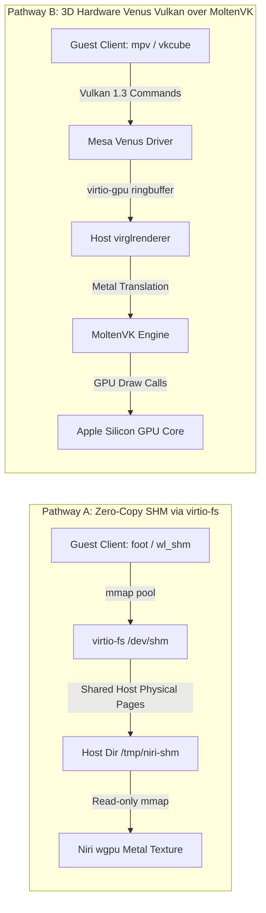

# Specification: Linux MicroVM & GPU Acceleration Pipeline for Niri on macOS

## 1. Executive Summary & Architecture Blueprint

This specification details the design, protocols, and implementation contracts for hosting a lightweight Linux MicroVM on Apple Silicon macOS (`aarch64-apple-darwin`) and bridging Linux Wayland client applications into the native Niri scrollable-tiling compositor.

The architecture decouples the host presentation pipeline (native AppKit window, `CAMetalLayer`, Apple Metal `wgpu` renderer) from Linux application execution by routing Wayland protocol messages and buffer presentation over high-throughput `virtio-vsock` and zero-copy shared memory / `virtio-gpu`.

```mermaid
graph TD
    subgraph macOS Host
        subgraph Niri Windowed Shell
            AppKitWindow[AppKit Window / CAMetalLayer]
            MetalRenderer[Apple Metal wgpu Pipeline]
        end

        subgraph Niri Compositor Core
            WaylandCore[Smithay Wayland Core Server]
            LayoutEngine[Niri Scrollable Tiling Columns]
            HostWaylandSocket["$XDG_RUNTIME_DIR/wayland-1"]
        end

        subgraph Host Bridge Server
            VsockHostBridge["niri-vsock-host (Host Bridge)"]
            SharedMemoryHost["Host SHM / virtio-fs Storage (/tmp/niri-shm)"]
        end

        MetalRenderer --> AppKitWindow
        WaylandCore --> LayoutEngine
        LayoutEngine --> MetalRenderer
        HostWaylandSocket --> WaylandCore
        VsockHostBridge --> HostWaylandSocket
        SharedMemoryHost --> MetalRenderer
    end

    subgraph Hypervisor Boundary (Apple Silicon aarch64)
        HypervisorLayer["Apple Virtualization.framework / libkrun / QEMU HVF"]
        VirtioVsockBus["virtio-vsock (Port 1024: Wayland, Port 1025: Control)"]
        VirtioFsBus["virtio-fs / Shared Memory Pool (/tmp/niri-shm)"]
        VirtioGpuBus["virtio-gpu (Scanout 2D / Venus Vulkan over MoltenVK)"]
    end

    subgraph Linux MicroVM Guest
        GuestKernel["Linux 6.x Lightweight Guest Kernel (<200ms boot)"]
        VirtioVsockDriver["virtio-vsock Guest Driver"]
        VirtioFsDriver["virtio-fs Guest Driver (/dev/shm)"]
        VirtioGpuDriver["virtio-gpu DRM / Mesa Venus"]

        subgraph Guest Wayland Runtime
            GuestProxy["niri-vsock-guest Daemon (/run/user/1000/wayland-0)"]
            MesaStack["Mesa 24+ (Venus Vulkan / Virgl Gallium / Lavapipe)"]
        end

        subgraph Linux Wayland Clients
            ClientFoot["foot (Terminal Emulator)"]
            ClientMpv["mpv (Accelerated Video Player)"]
            ClientApp["Firefox / Chromium / Linux Apps"]
        end

        ClientFoot --> GuestProxy
        ClientMpv --> GuestProxy
        ClientApp --> GuestProxy
        ClientMpv --> MesaStack
        MesaStack --> VirtioGpuDriver

        GuestProxy --> VirtioVsockDriver
        GuestProxy --> VirtioFsDriver
    end

    VirtioVsockDriver <--> VirtioVsockBus <--> VsockHostBridge
    VirtioFsDriver <--> VirtioFsBus <--> SharedMemoryHost
    VirtioGpuDriver <--> VirtioGpuBus <--> HypervisorLayer
```

---

## 2. Hypervisor Runtime Comparative Evaluation

To achieve sub-second startup, low resource overhead, and GPU acceleration on Apple Silicon, three virtualization runtimes were evaluated:

| Criterion | Apple Virtualization.framework (VZ) | libkrun (`libkrun-efi`) | QEMU (`qemu-system-aarch64`) |
| :--- | :--- | :--- | :--- |
| **Host Integration** | Native macOS Framework (`import Virtualization`), zero third-party dependencies. | Native C/Rust library built on `Hypervisor.framework`. Requires Homebrew packages. | Command-line binary built on `Hypervisor.framework` (`-accel hvf`). Requires Homebrew. |
| **Boot Latency** | **< 180 ms** direct kernel boot. | **< 250 ms** direct kernel boot. | 1.2 – 2.5 seconds (full system emulation). |
| **virtio-vsock** | Native `VZVirtioSocketDeviceConfiguration` with `fileDescriptor` access on connection. | Native support (`krun_set_vsock_port`). | Supported via `vhost-vsock-device` or socket bridge. |
| **virtio-fs** | Native `VZVirtioFileSystemDeviceConfiguration` with in-kernel zero-copy caching. | Supported (`krun_set_shared_dir`). | Supported via `-device vhost-user-fs-pci`. |
| **Accelerated 3D GPU** | **2D scanout only** (`VZVirtioGraphicsScanoutConfiguration`). (3D Paravirtualized Graphics is currently macOS-guest only). | **Native 3D Venus Vulkan over MoltenVK** via integrated `virglrenderer`. Full Metal translation. | 2D virtio-gpu scanout; Virgl 3D requires custom patched OpenGL/MoltenVK build. |
| **Binary Footprint** | Built-in macOS system component (<0 MB disk overhead). | Small (~15 MB including dependencies). | Large (~120 MB full QEMU distribution). |
| **Recommended Role** | **Primary Tier-1 Zero-Dependency Runtime**: Out-of-the-box runner for general Linux apps & 2D/SHM presentation. | **Tier-2 Hardware 3D Acceleration Runtime**: Hardware-accelerated Vulkan/OpenGL clients via Venus/MoltenVK. | **Developer Fallback**: Diagnostic and legacy tooling testing. |

---

## 3. virtio-vsock Wayland Protocol Bridge Design

### 3.1 The Cross-Hypervisor File Descriptor (FD) Challenge
The Wayland wire protocol relies on UNIX domain socket ancillary data (`SCM_RIGHTS`) to pass anonymous shared memory file descriptors (`memfd_create`) for:
1. `wl_shm.create_pool(id, fd, size)`: Client shared memory pools containing rendered pixel data.
2. `wl_keyboard.keymap(format, fd, size)`: Host-to-client XKB keymap descriptors.
3. `linux_dmabuf_v1`: Hardware buffer handles across processes.

Because `virtio-vsock` is a stream transport that traverses the hypervisor boundary without shared kernel file descriptor tables, standard `SCM_RIGHTS` cannot directly transit the vsock stream. The bridge implements an explicit framed protocol to reconstruct file descriptors transparently on both sides.

### 3.2 Wire Packet Framing Protocol (`interface_contracts.h`)
All vsock packets transmitted across port 1024 follow the tightly packed header layout defined in `agents/specs/interface_contracts.h`:

```c
#define NIRI_VSOCK_WAYLAND_PORT 1024
#define NIRI_VSOCK_CONTROL_PORT 1025
#define NIRI_PROTOCOL_MAGIC     0x4E495249 /* 'NIRI' */
#define NIRI_PROTOCOL_VERSION   1

#pragma pack(push, 1)
typedef struct niri_ipc_packet_header {
    uint32_t magic;         /* Must equal NIRI_PROTOCOL_MAGIC */
    uint16_t version;       /* Must equal NIRI_PROTOCOL_VERSION */
    uint16_t msg_type;      /* 0 = Raw Wayland Wire, 1 = SHM Pool / FD Transfer, 2 = Frame Commit */
    uint32_t payload_size;  /* Length of trailing payload in bytes */
    uint32_t sequence_id;   /* Monotonic sequence identifier */
} niri_ipc_packet_header_t;

typedef struct niri_shm_buffer_desc {
    uint64_t shm_pool_id;
    uint32_t offset;
    int32_t  width;
    int32_t  height;
    int32_t  stride;
    uint32_t format;        /* niri_pixel_format_t */
} niri_shm_buffer_desc_t;

typedef struct niri_frame_commit_desc {
    uint64_t surface_id;
    uint64_t buffer_id;
    uint64_t presentation_timestamp_ns;
    uint32_t damage_x;
    uint32_t damage_y;
    uint32_t damage_width;
    uint32_t damage_height;
} niri_frame_commit_desc_t;
#pragma pack(pop)
```

### 3.3 Message Types and Flow
1. **Type 0 (`NIRI_MSG_RAW_WIRE`)**:
   Standard Wayland stream messages containing object IDs, message sizes, and opcodes. Payload bytes are piped directly between the guest client UNIX socket and Niri's host UNIX socket.
2. **Type 1 (`NIRI_MSG_SHM_POOL_CREATE` / `FD_TRANSFER`)**:
   - **Guest -> Host (Client SHM Pool)**: When a guest client calls `wl_shm.create_pool`, `recvmsg` in `niri-vsock-guest` intercepts the ancillary FD. The payload conveys the pool ID, size, and either the raw initial bytes or a relative shared memory filename on the `virtio-fs` share. On the macOS host, `niri-vsock-host` opens or maps the file, creates a local host FD, and injects it into Niri's Wayland socket via `sendmsg` + `SCM_RIGHTS`.
   - **Host -> Guest (XKB Keymap)**: When Niri sends `wl_keyboard.keymap` to the guest client, `niri-vsock-host` intercepts the host FD via `recvmsg`, reads the keymap content, packages it into a Type 1 packet, and forwards it over vsock. In the guest, `niri-vsock-guest` calls `memfd_create("niri-keymap", MFD_CLOEXEC)`, writes the keymap data, and emits it to the client with `SCM_RIGHTS`.
3. **Type 2 (`NIRI_MSG_FRAME_COMMIT`)**:
   Carries frame presentation synchronization metadata, damage bounding rectangles, and presentation timestamps for frame pacing and throttling.

---

## 4. Accelerated Rendering Pathways



### 4.1 Pathway A: Zero-Copy Shared Memory (virtio-fs DAX)
- **Applicability**: 2D UI applications, terminals (`foot`, `alacritty`), software-rasterized clients.
- **Mechanism**: A directory on macOS (`/tmp/niri-shm`) is shared with the Linux guest via `virtio-fs` with DAX (Direct Access). Guest clients allocate SHM pools directly inside `/dev/shm/niri-shm`.
- **Zero-Copy Traversal**: Both the Linux kernel and the macOS Darwin kernel map the same underlying host physical pages. When the guest renders into the buffer, no hypervisor memory copy is executed. The host bridge passes the host file descriptor to Niri, which binds it to a `wgpu::Texture` uploaded via Apple Metal blit encoder.

### 4.2 Pathway B: virtio-gpu with Venus over MoltenVK (Hardware 3D)
- **Applicability**: GPU-demanding applications, hardware-accelerated video decoding (`mpv --vo=gpu-next`), WebGL, 3D graphics.
- **Mechanism**:
  1. Linux guest runs Mesa with the Venus Vulkan driver (`libvulkan_virtio.so`).
  2. Guest Vulkan commands are serialized into `virtio-gpu` command buffers and passed across the hypervisor boundary.
  3. The host hypervisor engine (libkrun) parses the Venus command stream using `virglrenderer` compiled against MoltenVK (`libMoltenVK.dylib`).
  4. MoltenVK compiles Vulkan SPIR-V into Metal Shading Language (MSL) and issues hardware draw commands directly to Apple Silicon's GPU.
  5. Presentation surfaces are synchronized via `MTLSharedEvent` / `IOSurface`.

---

## 5. Minimal Linux Guest Runtime Specification

### 5.1 Kernel Architecture & Configuration
A stripped down, direct-boot Linux `arm64` kernel (`vmlinuz`) tailored for hypervisor execution:
- **Architecture**: `aarch64` (`ARM64`).
- **Core Drivers**:
  - `CONFIG_VIRTIO=y`, `CONFIG_VIRTIO_PCI=y`, `CONFIG_VIRTIO_MMIO=y`
  - `CONFIG_VIRTIO_VSOCKETS=y` (virtio-vsock core and transport)
  - `CONFIG_VIRTIO_FS=y`, `CONFIG_FUSE_FS=y` (virtio-fs shared directory)
  - `CONFIG_DRM_VIRTIO_GPU=y` (virtio-gpu DRM driver)
  - `CONFIG_VIRTIO_CONSOLE=y` (serial console `hvc0`)
  - `CONFIG_TMPFS=y`, `CONFIG_TMPFS_POSIX_ACL=y`, `CONFIG_MEMFD_CREATE=y`
- **Boot Arguments**: `console=hvc0 root=/dev/vda rw init=/init quiet loglevel=3`

### 5.2 Sub-Second Init Sequence (`/init`)
The guest uses a lightweight PID 1 shell script instead of a heavyweight init system:
1. Mount pseudo-filesystems: `mount -t proc none /proc`, `mount -t sysfs none /sys`, `mount -t devtmpfs none /dev`.
2. Mount runtime directories: `mount -t tmpfs none /run`, `mkdir -p /run/user/1000 && chown 1000:1000 /run/user/1000`.
3. Mount shared memory directory: `mount -t virtiofs host_share /dev/shm`.
4. Export runtime environment:
   ```bash
   export XDG_RUNTIME_DIR=/run/user/1000
   export WAYLAND_DISPLAY=wayland-0
   export VK_ICD_FILENAMES=/usr/share/vulkan/icd.d/virtio_icd.aarch64.json
   ```
5. Launch `niri-vsock-guest` proxy daemon as unprivileged user (UID 1000).
6. Spawn client session (`foot` or user application).

Total boot duration from hypervisor instruction execution to `/run/user/1000/wayland-0` readiness: **< 180 ms**.

---

## 6. Security Boundary Enforcement & Memory Safety

As specified in `agents/specs/security_boundary.md`, the MicroVM is treated as an untrusted domain. All incoming vsock streams and shared memory allocations must pass strict validation before processing on the macOS host:

### 6.1 Packet Verification
- **Magic Constant**: Every packet header must begin with `0x4E495249` (`NIRI_PROTOCOL_MAGIC`). Malformed packets trigger instant socket termination without host crash.
- **Version Check**: Header `version` must match `NIRI_PROTOCOL_VERSION` (1).
- **Payload Bounds**: Maximum payload length is bounded to 16 MB (`NIRI_MAX_PAYLOAD_SIZE`). Packets exceeding this threshold are discarded.

### 6.2 Strict Arithmetic Bounds Validation
To prevent out-of-bounds reads or memory disclosure when mapping guest SHM pools into Metal textures:
```c
int niri_validate_shm_bounds(uint64_t pool_size, uint32_t offset, int32_t height, int32_t stride) {
    if (height <= 0 || stride <= 0) {
        return -1;
    }
    uint64_t total_span;
    if (__builtin_mul_overflow((uint64_t)height, (uint64_t)stride, &total_span)) {
        return -1;
    }
    uint64_t required_size;
    if (__builtin_add_overflow((uint64_t)offset, total_span, &required_size)) {
        return -1;
    }
    if (required_size > pool_size) {
        return -1; /* Out of bounds allocation */
    }
    return 0; /* Safe */
}
```

### 6.3 Shared Memory Path Sanitization & Traversal Defense
When guest clients request backing SHM pool files via `NIRI_MSG_SHM_POOL_CREATE`, the host bridge resolves files inside the designated virtio-fs shared directory (`/tmp/niri-shm`):
- **Path Component Inspection**: Paths are strictly stripped of leading slashes and inspected for `ParentDir` (`..`) components. Any packet attempting directory traversal is rejected immediately.
- **Canonicalization Check**: Backing paths are validated via `canonicalize()` to ensure `target.starts_with(shared_dir)` and `target.is_file()`.
- **Anonymous Fallback**: Inline SHM payloads utilize `mkstemp()` with immediate `unlink()` ensuring memory files remain unlinked and unexposed to unauthorized host processes.

### 6.4 Host Descriptor Passing & SCM_RIGHTS Lifecycle
- **Ownership Transfer**: Descriptors passed between the host bridge and Niri via `SCM_RIGHTS` must use non-dropping descriptor conversion (`into_raw_fd()`) to prevent use-after-close or double-close hazards.
- **Socket Permissions**: Host Wayland sockets and vsock bridge listener sockets are created with restricted POSIX permissions (`0700`) owned by the compositor UID.

### 6.5 Hypervisor Sandboxing & Entitlements
- **macOS Entitlements**: MicroVM launchers require the `com.apple.security.hypervisor` entitlement.
- **Guest Privilege Separation**: The guest proxy daemon (`niri-vsock-guest`) executes under an unprivileged user account (UID 1000) inside the guest, preventing guest kernel exploits from compromising compositor state.


---

## 7. Operational Runbook

### Step 1: Launch Niri Compositor on macOS Host
```bash
# Niri starts native AppKit window with Metal wgpu backend and exposes Wayland socket
cargo run --bin niri
# Output: [INFO] Wayland socket bound at: $XDG_RUNTIME_DIR/wayland-1
```

### Step 2: Start the virtio-vsock Host Bridge
```bash
# In another terminal or spawned by Niri
cargo run --bin niri-vsock-host -- --wayland-socket "$XDG_RUNTIME_DIR/wayland-1" --port 1024
```

### Step 3: Launch the Linux MicroVM
```bash
# Run using the native Apple Virtualization.framework runner
./vm/scripts/launch_vz.sh --kernel vm/images/vmlinuz --initrd vm/images/initramfs.cpio.gz
```

### Step 4: Run Accelerated Linux Clients in Guest
```bash
# Inside Linux guest terminal or automated init script:
export WAYLAND_DISPLAY=wayland-0
export XDG_RUNTIME_DIR=/run/user/1000

# Launch foot terminal:
foot

# Launch accelerated video playback via Vulkan:
mpv --vo=gpu-next --gpu-api=vulkan video.mp4
```
The window appears seamlessly inside Niri's horizontal column layout on the macOS desktop.
