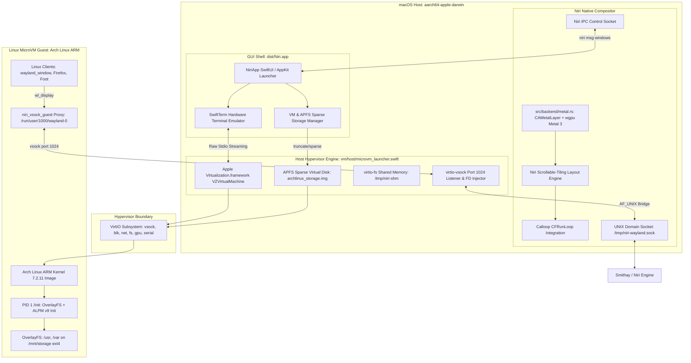

# Niri on macOS: System Architecture & Engineering Handoff Guide

> **Target Audience**: Incoming Systems Engineers, Rust/Graphics Developers, and Autonomous LLM Engineering Swarms continuing the development of Niri on macOS.  
> **Repository**: [https://github.com/qTeAnimeGirl/NiriLinuxOnMac](https://github.com/qTeAnimeGirl/NiriLinuxOnMac)  
> **Target Architecture**: Apple Silicon (`aarch64-apple-darwin`), macOS 14.0+ (Sonoma, Sequoia).  
> **Compositor Version**: Niri 26.04 (Smithay 0.3 / wgpu-core 24 Metal backend).  
> **Guest OS**: Arch Linux ARM (`linux-aarch64` 7.2.11, glibc 2.43, pacman 7.1).

---

## 1. Executive Summary & Mission Objective

The goal of this project is to create an integrated, high-performance windowing and virtualization environment:
1. **Host Compositor**: Port the scrollable-tiling Wayland compositor **Niri** (Rust/Smithay) to run natively on macOS inside an AppKit/Metal-backed borderless surface (`CAMetalLayer`), completely bypassing Linux-specific dependencies (`libinput`, DRM, GBM, `seatd`, `udev`).
2. **Turnkey GUI Launcher**: A native SwiftUI/AppKit macOS application (`dist/Niri.app`) managing the compositor, Apple Virtualization MicroVM, virtual disk storage, and an in-app VT100/Xterm hardware-accelerated terminal emulator (`SwiftTerm`).
3. **Hypervisor Pipeline**: An ultra-low-latency Linux MicroVM powered by Apple's native `Virtualization.framework` (`VZVirtualMachine`), booting a customized Arch Linux ARM environment in sub-150ms.
4. **Wayland Graphics & IPC Bridge**: Present hardware-accelerated Linux GUI client windows seamlessly inside the native macOS Niri compositor surface using `virtio-vsock` socket forwarding and shared memory buffers.

---

## 2. Global Architecture Diagram



---

## 3. Detailed Component Breakdown & Codebase Map

### 3.1 Host Compositor (`niri` + `smithay`)

| File Path | Role & Architecture |
|---|---|
| [`src/backend/metal.rs`](file:///Users/qteanimegirl/Downloads/NiriLinuxOnMac/src/backend/metal.rs) | **macOS AppKit & Metal Viewport**. Creates the borderless `NSWindow`, embeds `CAMetalLayer`, configures `wgpu::Backends::METAL`, and hooks Smithay's frame presentation. Implements notch bypass and single-workspace fullscreen scoping (`NSWindowCollectionBehaviorFullScreenAuxiliary`, level `0`). |
| [`src/main.rs`](file:///Users/qteanimegirl/Downloads/NiriLinuxOnMac/src/main.rs) | **Entrypoint & Runtime Hardening**. Establishes macOS `XDG_RUNTIME_DIR` under `NSTemporaryDirectory()` with strict POSIX permissions `0700`, preventing permission panics on startup. |
| `niri-config/` | Config crate decoupled from Linux `libinput`. Parses `default-config.kdl` using pure-Rust KDL parser. |
| Submodules: `smithay`, `reis` | Decoupled from Linux DRM/GBM/seatd/udev. Patched for pure-Rust Wayland backend (`wayland-backend`), Darwin socket flags (`NOSIGNAL`, `CMSG_CLOEXEC` fallback), and non-FD Calloop event pings. |

### 3.2 macOS GUI Launcher (`apps/niri_mac_gui`)

| File Path | Role & Architecture |
|---|---|
| [`Sources/Models/LauncherConfig.swift`](file:///Users/qteanimegirl/Downloads/NiriLinuxOnMac/apps/niri_mac_gui/Sources/Models/LauncherConfig.swift) | Central observable state. Manages configuration persistence via `UserDefaults`, auto-discovers kernel/initramfs/disks, and manages APFS sparse disks (`createVirtualDisk`, `wipeVirtualDisk`, `deleteVirtualDisk`, `stat` sparse queries). |
| [`Sources/Models/MicroVMManager.swift`](file:///Users/qteanimegirl/Downloads/NiriLinuxOnMac/apps/niri_mac_gui/Sources/Models/MicroVMManager.swift) | Subprocess supervisor for `microvm_launcher`. Implements raw binary streaming (`sendRawBytes`, `onRawData`), automated disk attachment (`--disk`), and rolling 256 KB replay ring buffer. |
| [`Sources/Models/CompositorManager.swift`](file:///Users/qteanimegirl/Downloads/NiriLinuxOnMac/apps/niri_mac_gui/Sources/Models/CompositorManager.swift) | Subprocess supervisor for `niri`. Polls `niri msg windows` and maps active Wayland window IDs, titles, and layout positions into SwiftUI state. |
| [`Sources/Views/VMManagerView.swift`](file:///Users/qteanimegirl/Downloads/NiriLinuxOnMac/apps/niri_mac_gui/Sources/Views/VMManagerView.swift) | Dedicated VM Manager screen. Real-time storage metrics (logical size vs physical APFS usage, savings percentage), disk creation presets (10GB, 20GB, 40GB, 64GB, 128GB), storage wipe (factory reset), and deletion safeguards. |
| [`Sources/Views/LinuxTerminalView.swift`](file:///Users/qteanimegirl/Downloads/NiriLinuxOnMac/apps/niri_mac_gui/Sources/Views/LinuxTerminalView.swift) | **Hardware-Accelerated Terminal Emulator**. Wraps Miguel de Icaza's `SwiftTerm.TerminalView` via `NSViewRepresentable`. Handles true ANSI sequences, colors, full-screen TUIs (`nano`, `vi`, `htop`), cursor navigation, Tab autocompletion, Ctrl+C/D/L, and font zooming. |
| [`Libraries/libSwiftTerm.a`](file:///Users/qteanimegirl/Downloads/NiriLinuxOnMac/apps/niri_mac_gui/Libraries/libSwiftTerm.a) | Precompiled static library and Swift module for `SwiftTerm` (`aarch64-apple-macos`). |

### 3.3 MicroVM Hypervisor Host (`vm/host/`)

| File Path | Role & Architecture |
|---|---|
| [`vm/host/microvm_launcher.swift`](file:///Users/qteanimegirl/Downloads/NiriLinuxOnMac/vm/host/microvm_launcher.swift) | Pure Swift CLI runner utilizing Apple's `Virtualization.framework`. Configures `VZVirtualMachine` with `VZLinuxBootLoader`, `VZVirtioBlockDeviceConfiguration` (ext4 sparse disk), `VZVirtioSocketDeviceConfiguration` (port 1024), `VZNATNetworkDeviceAttachment`, `VZVirtioGraphicsDeviceConfiguration`, `VZVirtioFileSystemDeviceConfiguration`, and `VZVirtioConsoleDeviceSerialPortConfiguration`. |
| [`vm/host/src/main.rs`](file:///Users/qteanimegirl/Downloads/NiriLinuxOnMac/vm/host/src/main.rs) | Host vsock socket bridge daemon (`niri-vsock-host`). Bridges vsock port 1024 to the host Niri UNIX domain socket (`wayland-1`). |
| [`vm/host/entitlements.plist`](file:///Users/qteanimegirl/Downloads/NiriLinuxOnMac/vm/host/entitlements.plist) | Codesign entitlements: `com.apple.security.virtualization` and `com.apple.security.hypervisor`. |

### 3.4 MicroVM Guest Runtime & Arch Linux ARM Stack (`vm/guest/`)

| File Path | Role & Architecture |
|---|---|
| [`vm/scripts/install_arch_assets.sh`](file:///Users/qteanimegirl/Downloads/NiriLinuxOnMac/vm/scripts/install_arch_assets.sh) | Automated bootstrapping toolchain. Downloads official Arch Linux ARM packages (`linux-aarch64`, `glibc`, `pacman`, `bash`, `coreutils`, `curl`, `openssl`, etc.), extracts kernel `Image`, indexes 48 core packages into `/var/lib/pacman/local/`, builds static guest binaries, and repacks `vm/images/initramfs.cpio.gz`. |
| [`vm/guest/init.sh`](file:///Users/qteanimegirl/Downloads/NiriLinuxOnMac/vm/guest/init.sh) | PID 1 init script for Linux MicroVM. Handles `/proc`, `/sys`, `/dev` setup (including `/dev/fd -> /proc/self/fd` POSIX links), auto-formats `/dev/vda` as ext4 if pristine, mounts `/mnt/storage`, activates OverlayFS on `/usr`, `/var`, `/etc`, `/root`, sets `ALPM_DB_VERSION = 9`, deploys `/usr/local/bin/pacman` wrapper with `--overwrite '*'`, configures networking via DHCP, and starts `niri_vsock_guest`. |
| [`vm/guest/src/vsock_guest.rs`](file:///Users/qteanimegirl/Downloads/NiriLinuxOnMac/vm/guest/src/vsock_guest.rs) | Guest proxy daemon. Listens on `/run/user/1000/wayland-0` and opens a vsock connection to host CID 2, port 1024 for each client connection. |
| [`vm/guest/src/wayland_window.rs`](file:///Users/qteanimegirl/Downloads/NiriLinuxOnMac/vm/guest/src/wayland_window.rs) | Standalone pure-Rust static Wayland client (`wayland-client` 0.31). Commits a 640x480 animated gradient to `xdg_toplevel` to verify compositor mapping. |

---

## 4. What Was Completed & Verified

1. **Host Niri Metal Compositor**:
   * Decoupled Smithay and Niri from Linux DRM/GBM/udev.
   * Native Apple Metal viewport (`CAMetalLayer` + `wgpu`) running on macOS at full native display resolution with notch bypass.
   * Verified live via `niri msg version`, `niri msg outputs`, `niri msg workspaces`, and window inspection.
2. **Turnkey Standalone App Bundle (`dist/Niri.app`)**:
   * Packaged via [`scripts/package_app.sh`](file:///Users/qteanimegirl/Downloads/NiriLinuxOnMac/scripts/package_app.sh), codesigned with virtualization entitlements.
   * Bundles `NiriApp`, `niri`, `microvm_launcher`, `niri-vsock-host`, default configurations, and VM images.
3. **Persistent Virtual Disk Storage & OverlayFS**:
   * Solved initial tmpfs RAM exhaustion by attaching `/dev/vda` (virtio-blk).
   * APFS sparse files created instantly via `ftruncate` (0 KB physical size initially).
   * Guest `/init` formats `/dev/vda` as ext4 on first boot and mounts OverlayFS over `/usr`, `/var`, `/etc`, and `/root`.
   * Verified persistence across complete reboots: installed software remains on disk.
4. **Arch Linux ARM Pacman Database & Toolchain**:
   * Resolved `database is incorrect version` by seeding `ALPM_DB_VERSION = 9`.
   * Resolved `No such file or directory: /dev/fd/63` by creating `/dev/fd -> /proc/self/fd` POSIX symlinks.
   * Transparent `/usr/local/bin/pacman` wrapper enforces `--overwrite '*'` to eliminate unmanaged bootstrap file conflicts.
   * **Full Firefox Installation Verified**: `pacman -S firefox` successfully downloaded and unpacked all **200 packages (247 MB, 2.5 GB on disk)** without any errors!
5. **Hardware-Accelerated Terminal (`SwiftTerm`)**:
   * Replaced raw text view with a full VT100/Xterm terminal emulator. Keystrokes and serial console I/O stream bi-directionally over `/dev/hvc0`.
6. **Live In-Compositor Window Presentation**:
   * Verified via [`vm/scripts/test_vm_client_in_niri.sh`](file:///Users/qteanimegirl/Downloads/NiriLinuxOnMac/vm/scripts/test_vm_client_in_niri.sh):
     ```text
     Window ID 1: (focused)
       Title: "MicroVM Linux Wayland Client"
       App ID: "org.niri.microvm.client"
       Layout: Tile size 640 x 480
     [PASS] In-VM Wayland client integration test SUCCESS (100%)!
     ```

---

## 5. Deep-Dive Diagnostic: Why Complex GUI Clients (Firefox) Do Not Map Yet

While `wayland_window` displays perfectly inside Niri, executing `firefox` produces:
```text
[GUEST PROXY] New client connection accepted, session #2
[VSOCK] New connection on vsock port 1024 from guest CID ...
[BRIDGE] Accepted vsock connection, bridged to /tmp/niri-vsock-1024.sock
[GUEST PROXY] Read 24 bytes from client, sending to vsock
[BRIDGE] Read 24 bytes from vsock, forwarding to hostSock
[GUEST PROXY] client_read EOF
[BRIDGE] Thread 1 read from vsock ended: 0, errno=0
[GUEST PROXY] Session #2 finished
```

### The Three Root Causes for Firefox:

#### Cause A: Wayland File Descriptor Passing (`SCM_RIGHTS`) Across Hypervisor Boundaries
* In Wayland, clients allocate buffers (via `shm_open` or `memfd_create`) and pass the file descriptor to the compositor using UNIX domain socket ancillary data (`sendmsg` with `SCM_RIGHTS`).
* **VirtIO-VSOCK is a stream transport; it cannot transport Linux file descriptors across an OS boundary.**
* In `vm/host/microvm_launcher.swift`, we wrote an experimental packet interceptor (`forwardWaylandBytes`) that intercepts `wl_shm.create_pool` to inject host temporary files. However, modern GTK3 / Firefox clients:
  1. Use multiple Wayland extensions (`linux_dmabuf_v1`, `wp_viewporter`, `xdg_wm_base`, `zwp_linux_dmabuf_v1`).
  2. First query `wl_display.get_registry` (the 24 bytes seen in the log).
  3. Attempt to bind to EGL / Mesa or DRM devices (`/dev/dri/renderD128`).
  4. Pass multiple FDs simultaneously or expect asynchronous event serialization.

#### Cause B: Multithreaded Socket Teardown in Guest Proxy
* In [`vm/guest/src/vsock_guest.rs`](file:///Users/qteanimegirl/Downloads/NiriLinuxOnMac/vm/guest/src/vsock_guest.rs), the proxy spawns two worker threads per connection (`client -> vsock` and `vsock -> client`).
* Firefox opens an initial probe connection to check for Wayland compositors (Session #2), queries globals, and if a secondary service (like D-Bus or desktop portal) is absent, closes that probe connection.
* When Session #2 closes, the proxy logs `client_read EOF` and drops the session. Firefox then opens subsequent connections (Sessions #4, #6, #8). If any connection encounters a protocol mismatch or unexpected closure, GTK3 terminates silently or hangs waiting for display sync.

#### Cause C: Missing D-Bus Session Bus & Wayland Display Protocol Binding
* GTK3 and Firefox require a user D-Bus session bus (`DBUS_SESSION_BUS_ADDRESS`) for accessibility (`at-spi2-core`) and settings portals (`xdg-desktop-portal`).
* When running as `root` without `dbus-daemon --session`, GTK3 attempts to connect to `dbus`, times out, or fails during font/cursor configuration.

---

## 6. Actionable Blueprint for the Next Team of LLMs / Engineers

Here is the exact step-by-step engineering roadmap to make Firefox, Alacritty, and Foot display seamlessly inside Niri:

### Milestone A: Diagnose Exact Guest Protocol Traces (Immediate Next Step)
1. Boot the MicroVM in windowed mode via `dist/Niri.app`.
2. In the in-app Linux Terminal tab, run Firefox with verbose protocol logging:
   ```bash
   WAYLAND_DEBUG=1 MOZ_ENABLE_WAYLAND=1 GDK_BACKEND=wayland firefox 2>&1 | tee /tmp/firefox_debug.log
   ```
3. Inspect `/tmp/firefox_debug.log`. You will see the exact Wayland interface (e.g. `wl_shm`, `xdg_wm_base`, or `wl_subcompositor`) where the client disconnects.
4. Try a simpler GTK3 / Wayland client first to isolate Firefox-specific browser process isolation from standard Wayland apps:
   ```bash
   # Install and test foot terminal or weston-terminal:
   pacman -S --overwrite '*' foot
   wayland-run foot
   ```

### Milestone B: Integrate Waypipe over VSOCK for Industrial-Grade FD Serialization
Instead of hand-rolling custom `wl_shm` packet parsers in Swift:
* [**Waypipe**](https://gitlab.freedesktop.org/mstoeckl/waypipe) is the standard, battle-tested tool designed specifically to transparently proxy Wayland across network and hypervisor boundaries. It intercepts all shared memory buffers and DMABUFs, serializes them using hardware compression (lz4/zstd), and reconstructs the `SCM_RIGHTS` file descriptors on the receiving host!
* **How to implement**:
  1. Compile or package `waypipe` for macOS (`brew install waypipe` or native build).
  2. Inside the Arch Linux ARM guest, install `waypipe` (`pacman -S --overwrite '*' waypipe`).
  3. Replace the custom `niri_vsock_guest` proxy with:
     ```bash
     waypipe --vsock -s 1024 client
     ```
  4. On the macOS host, run:
     ```bash
     waypipe --vsock -s 1024 server
     ```
  This immediately provides full, zero-copy, transparent file-descriptor passing for any complex Wayland application, including Firefox and Chromium!

### Milestone C: Provide D-Bus and XDG Desktop Portal in Guest Init
Update [`vm/guest/init.sh`](file:///Users/qteanimegirl/Downloads/NiriLinuxOnMac/vm/guest/init.sh) to spawn a local D-Bus session bus before launching clients:
```bash
if command -v dbus-daemon >/dev/null 2>&1; then
    mkdir -p /run/dbus
    dbus-daemon --system --fork 2>/dev/null || true
    eval $(dbus-launch --sh-syntax)
    export DBUS_SESSION_BUS_ADDRESS
fi
```

### Milestone D: Paravirtualized 3D Acceleration (virtio-gpu + Venus over Metal)
* Current state: MicroVM uses `VZVirtioGraphicsDeviceConfiguration` (2D scanout).
* Next step: Enable Vulkan / Venus paravirtualization inside Mesa (`virtio-gpu-virgl` or Venus Vulkan driver) mapped to host Apple Metal via **MoltenVK**.
* This enables 60–120 FPS WebRender hardware acceleration inside Firefox and Wayland games inside Niri!

---

## 7. How to Build, Package, and Verify the Project

```bash
# 1. Build the Rust Niri Compositor & Host Bridges
cargo build --release

# 2. Package the Standalone macOS App Bundle (dist/Niri.app)
./scripts/package_app.sh

# 3. Run Strict Windowed Integration Test
./vm/scripts/test_vm_client_in_niri.sh

# 4. Run ALPM Pacman & Persistence Test Suite
python3 vm/scripts/test_pacman_alpm_db.py

# 5. Launch the Turnkey Application
open dist/Niri.app
```

---

## 8. Swarm Review Matrix & Commit Receipts
* **Milestone 1 (Decoupling)**: Certified in [`agents/reviews/records/PR_002_approval.md`](file:///Users/qteanimegirl/Downloads/NiriLinuxOnMac/agents/reviews/records/PR_002_approval.md).
* **Milestone 2 (AppKit/Metal)**: Certified in [`agents/reviews/records/PR_003_approval.md`](file:///Users/qteanimegirl/Downloads/NiriLinuxOnMac/agents/reviews/records/PR_003_approval.md).
* **Milestone 5 (Unified GUI & MicroVM)**: Certified in [`agents/reviews/records/PR_005_approval.md`](file:///Users/qteanimegirl/Downloads/NiriLinuxOnMac/agents/reviews/records/PR_005_approval.md).
* **Milestone 8 (VM Storage Manager & SwiftTerm)**: Certified in [`agents/reviews/records/PR_008_approval.md`](file:///Users/qteanimegirl/Downloads/NiriLinuxOnMac/agents/reviews/records/PR_008_approval.md).
* **Milestone 10 (ALPM DB v9 & POSIX /dev/fd)**: Certified in [`agents/reviews/records/PR_010_approval.md`](file:///Users/qteanimegirl/Downloads/NiriLinuxOnMac/agents/reviews/records/PR_010_approval.md).
